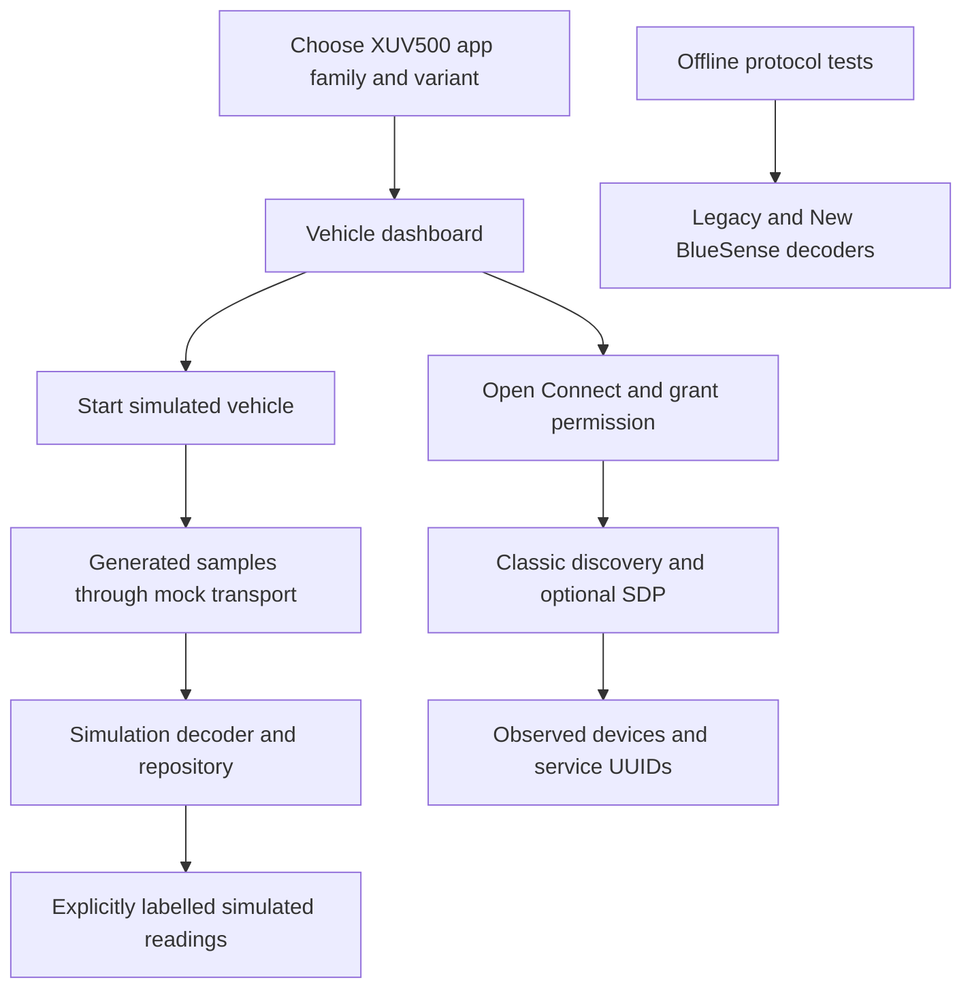

# OpenSense

[](https://github.com/Marshmellow31/OpenSense/actions/workflows/android.yml)
[](LICENSE)

An independent, native Android research preview for Mahindra XUV500 owners. Choose a Legacy or New BlueSense vehicle profile, explore a clearly labelled simulated dashboard, and inspect nearby Classic Bluetooth services.

OpenSense is unofficial and is not affiliated with Mahindra or the original BlueSense developers.

**Status: 0.1.0-dev · research preview.** The aim is a free, maintainable replacement
for compatible XUV500 BlueSense installations. The current APK is a functional
foundation with simulation and Bluetooth discovery; real vehicle telemetry and
controls are not enabled. The primary owner test target is a **2018 XUV500 W7**.

## Progress at a glance

Last evidence update: **16 October 2026**. See [PROGRESS.md](PROGRESS.md) for the
full handoff, remaining issues and validation boundaries.

| Workstream | Progress | Evidence / remaining work |
| --- | --- | --- |
| Identify both original app families | Complete for two selected artifacts | Package/version, hashes, manifests and signing checks recorded |
| Static whole-package analysis | Inventory and export complete; semantics partial | REA/JADX inspection plus Java/resources and Smali exports; decompiler limitations documented |
| Bluetooth and framing investigation | Established from static APK paths | Classic SPP in both apps, with different packet formats; vehicle captures still needed |
| Independent protocol decoders | Implemented and locally tested | Separate offline legacy/new decoders; no vehicle transmission |
| Vehicle-family / variant selection | Implemented | Legacy and New BlueSense profiles; selection is not compatibility detection |
| Simulated vehicle and app screens | Implemented | Dashboard, media/climate displays, feature states, diagnostics and settings |
| Bluetooth discovery / service inspection | Implemented; physical radio validation pending | Permission-aware Classic discovery and standard SDP |
| Local validation | Passing at current baseline | 28 JVM tests, 3 Python tests, 3 emulator UI tests; build and lint pass |
| Public CI / development APK | Verified | [Successful Linux CI run](https://github.com/Marshmellow31/OpenSense/actions/runs/38847498840) builds/tests/lints and provides `OpenSense-debug` |
| Real head-unit compatibility | Pending | Exact head-unit/firmware identification and consented parked captures |
| Vehicle controls | Disabled | Requires verified effects, hardware evidence and explicit owner approval |
| UI polish | In progress | Small-screen / large-font navigation clipping; landscape checks remain |

The table distinguishes static evidence, local test results and pending hardware
proof. Neither original app was installed or executed during this investigation.

## What works today

- Vehicle selection for the two historical BlueSense app families, followed by a variant choice. These are research profiles; selecting one does not establish compatibility.
- Simulated fuel, range, climate, and door status with explicit simulation labels.
- User-initiated Classic Bluetooth discovery and standard SDP service inspection, subject to Android permissions.
- A feature catalogue that keeps unverified capabilities unavailable, theme preferences, and bounded in-memory diagnostic events.

**Vehicle communication remains unverified.** The app opens no vehicle socket, sends no vehicle control commands, and receives no real vehicle telemetry. The `SIM1` codec is an invented test format, not a recovered BlueSense protocol. Static APK findings do not prove vehicle behavior.

The two research targets are the original `com.visteon` app, version `0.46`, and `com.contus.mahindra.xuv500`, version `3.5`. Use the research documentation for evidence and provenance; package names alone do not authenticate a publisher. Neither original app needs to be installed to build or run OpenSense.

## How this project was built

The investigation began with an empty workspace. Instead of assuming the two apps
shared a protocol, each artifact was identified and analyzed separately:

1. **Find and preserve the inputs.** Research manufacturer/developer documentation
   and archival version listings, then download the two selected APKs into a
   private input folder. Record source URLs, acquisition method, sizes and SHA-256.
2. **Check identity and declarations.** Use Android SDK `aapt2` for manifest/badging
   and `apksigner` for signature verification. A valid signature and matching archive
   fingerprint establish consistency, not independent publisher authentication.
3. **Inspect with [REA](https://github.com/morluto/rea).** Use its local CLI, version
   6.5.0, with JDK 21 and headless JADX 0.7.1. Verify the engine JAR against REA's
   pinned SHA-256 before use. Inspect package declarations, class inventories,
   selected methods and incoming references without launching either APK.
4. **Trace across the package.** Export the full Java/resources and class-level
   Smali privately, map application modules, then follow connection setup, socket
   reads/writes, framing, checksum and feature-dispatch paths. Keep decompiler errors
   explicit rather than treating generated Java as complete original source.
5. **Implement independently.** Write new Kotlin framing decoders and synthetic
   tests from the documented behavior. Build a separate Compose app, mock transport,
   lifecycle repository and capability model. Proprietary source and assets are
   not copied into the public implementation.
6. **Validate the foundation.** Exercise malformed/fragmented streams and connection
   lifecycle cases, build/lint the Android app, and test profile selection and
   simulation on an emulator. Hardware behavior remains a separate verification gate.

The legacy package has **268 class rows including inner classes / 58 top-level
classes**, with one Java decompilation error. The newer package has **4,170 rows /
2,095 top-level classes**, with eight errors and forty warnings. Smali exports
preserve further inspection paths. These counts describe inventory/export
coverage; they do not mean every method's behavior has been fully reconstructed.

### What the two protocols revealed

Both inspected connection paths use Bluetooth Classic serial communication and
the standard SPP UUID, but their wire formats are different:

| Family | Static connection evidence | Incoming framing / integrity |
| --- | --- | --- |
| Legacy `com.visteon` 0.46 | Secure RFCOMM socket factory | `ED` / `EE` binary envelope, length field and CRC-16 |
| New `com.contus.mahindra.xuv500` 3.5 | Insecure RFCOMM socket factory; legacy reflective fallback present | Nibble encoding with incoming 0x50 offset, length field and additive checksum |

OpenSense implements the framing as **offline parsers**. Sharing an SPP UUID does
not make the profiles interchangeable. Exact session requirements, telemetry
units, head-unit firmware behavior and per-variant support need corroborating
captures. The specifications include class/method anchors and REA Evidence IDs:
[protocol overview](docs/protocol.md), [legacy](docs/protocol-legacy.md),
[new BlueSense](docs/protocol-new.md).

## How the OpenSense APK works

OpenSense is a new native Android application, package `org.opensense.app`. It is
not a patched or repackaged BlueSense APK. It uses Kotlin, Jetpack Compose,
Material 3, a view model, coroutines and Flow, with three Gradle modules:

| Module | Responsibility |
| --- | --- |
| `app` | Screens, navigation, permissions, view model and theme/profile preferences |
| `core` | Capability/data models, simulation, repository lifecycle, offline decoders and diagnostic event types |
| `bluetooth` | Android Classic discovery and standard service discovery; no vehicle data socket |



**Simulation:** selecting Start simulated vehicle starts a cancellable sample
stream. The repository decodes the test-only `SIM1` format and publishes state to
the UI. These values are generated locally; they do not come from a car. Stopping
simulation, changing profiles or leaving the app clears the session/readings.

**Bluetooth:** selecting discovery stops simulation, checks Android permissions,
lists paired/nearby Classic devices and can request their standard SDP service
UUIDs. Device labels are generic; pairing and identification happen in Android
settings. OpenSense does not open an RFCOMM/GATT vehicle session or send startup,
query, acknowledgment or control commands.

**Capabilities:** selecting a trim records research context. Unsupported vehicle
features remain unavailable; demo support is labelled simulated. TPMS, EcoSense
and parked-location support are not inferred from the car name or original UI.

**Offline parsing:** the recovered framing decoders are libraries exercised by
tests. They do not feed the dashboard or turn a checksum-valid packet into a
trusted vehicle reading. The newer format requires a known frame boundary; its
stream parser stops on alignment loss rather than guessing synchronization.

**Storage and diagnostics:** only theme and selected vehicle profile persist.
Diagnostic events contain predefined codes and timestamps, are capped at 100
entries, and stay in memory. There is no account, analytics or cloud service.

## Get a development APK

Build locally using the instructions below, or open
[Android checks in GitHub Actions](https://github.com/Marshmellow31/OpenSense/actions/workflows/android.yml).
Select a successful run and download the **OpenSense-debug** artifact from its
Artifacts section. Unzip it to obtain `app-debug.apk`. Artifacts are generated
only when that run's checks pass and are retained for 14 days. GitHub may require
sign-in to download them.

This is a debug research build, not a production release or a verified vehicle
replacement. There is no published Play Store release. The original archival
APKs are not distributed in this repository or in CI artifacts.

The [first successful published build](https://github.com/Marshmellow31/OpenSense/actions/runs/38847498840)
is from commit `6c25274`, verified on 16 October 2026. Its `OpenSense-debug`
artifact is available until 30 October 2026; use a newer successful run after
that date or build locally. The final publication-status documentation update
does not change that tested application code.

## Build

Requirements: JDK 21, Android SDK platform 37, Build Tools 36.0.0, and Internet access for dependency downloads. The checked-in wrapper selects Gradle 9.5.0. The project uses AGP 9.3.0, Kotlin 2.3.21, and Compose BOM 2026.09.00. Minimum Android version is 8.0 (API 26); target and compile SDK are 37.

From PowerShell at the project root, substitute the actual installed JDK and SDK paths:

```powershell
$env:JAVA_HOME = 'C:\path\to\jdk-21'
$env:ANDROID_HOME = "$env:LOCALAPPDATA\Android\Sdk"
$env:Path = "$env:JAVA_HOME\bin;$env:Path"
& "$env:ANDROID_HOME\cmdline-tools\latest\bin\sdkmanager.bat" 'platforms;android-37.0' 'build-tools;36.0.0' 'platform-tools'
.\gradlew.bat :core:test :app:lintDebug :bluetooth:lintDebug :app:assembleDebug
```

If SDK licenses are requested, review and accept them using `sdkmanager.bat --licenses`. `ANDROID_HOME` can locate the SDK without checking in machine-specific `local.properties`. The debug APK is produced at `app/build/outputs/apk/debug/app-debug.apk`; it is a local development artifact, not a production release.

Android Studio must support AGP 9.3.0 for IDE sync. Use the command-line build if
your IDE version does not support the project's pinned plugin version.

On macOS/Linux, set `JAVA_HOME` and `ANDROID_HOME` to local installation paths and use `bash ./gradlew` with the same task names.

## Explore the app

1. Install your local debug build on a test phone and launch OpenSense.
2. Select the app family your head unit originally used, choose its variant (or “Other / unsure”), and continue. Year alone cannot identify a replacement head unit.
3. Select **Start simulated vehicle** to inspect generated examples. Stop simulation to clear the displayed data.
4. For discovery, open **Connect**, grant Nearby devices permission on Android 12+, or Location permission on Android 8–11. Earlier Android versions may also require system Location to be enabled. Pairing and identification take place in Android settings.
5. Change the selected profile or appearance under **Settings**. Leaving the app stops discovery and simulation; restarting either requires a user action.

Discovery results use generic device labels. A listed device or returned UUID does not prove BlueSense support. Do not interpret simulated values as vehicle measurements.

## Validation and next milestones

The recorded local baseline is **28 JVM tests**, **3 Python tests** and **3 Compose
UI tests** passing on an Android 16/API 36 emulator. App lint reported zero errors
and six warnings; Bluetooth lint reported zero errors and two warnings. These are
local results, distinct from the live CI badge above. The pipeline builds/lints
and runs JVM/Python tests; it currently does not run the emulator UI suite.

Next milestones:

- [ ] Fix navigation labels at 320 dp with larger fonts and complete landscape checks.
- [ ] Identify the primary W7's factory/replacement head unit and exact firmware.
- [ ] Corroborate both framing specifications with authorized parked captures.
- [ ] Confirm initialization effects, field validity, units and per-feature hardware.
- [ ] Implement and validate a separate read-only vehicle repository.
- [ ] Verify physical-phone permissions, radio coexistence and reconnection.
- [ ] Enable individual features only after evidence-backed compatibility checks.

Start with the [vehicle evidence checklist](docs/vehicle-test-plan.md). Testing
must be limited to an owned or explicitly authorized vehicle while safely parked.
Newly reverse-engineered controls require explicit owner approval; firmware changes,
authentication bypass and safety-critical ECU access are outside this project scope.

## Privacy and research materials

The app has no Internet permission, account, analytics, or cloud sync. Only theme and selected vehicle profile preferences are persisted. Diagnostic events contain predefined codes and timestamps; device names, Bluetooth addresses, raw packets, and exception text are not written into that diagnostic record.

Original APKs, decompiled source, packet captures, and private analysis stay outside public contributions. `apk-input/`, `private-analysis/`, and `tools-local/` are ignored. Do not attach those materials to public issues or releases. The optional static inventory utility is documented in [testing](docs/testing.md).

## Contribute

See [research](docs/research.md), [protocol findings](docs/protocol.md), [compatibility](docs/compatibility.md), [vehicle evidence needed](docs/vehicle-test-plan.md), [architecture](docs/architecture.md), [testing](docs/testing.md), [contribution guidance](CONTRIBUTING.md), and [security reporting](SECURITY.md). Current build and device validation evidence must be reported separately; a successful build does not establish real-car compatibility. Physical-device and vehicle verification remain pending.

OpenSense's original code is licensed under [MIT](LICENSE). This license does not grant rights to original BlueSense APKs, branding, or other third-party material. MIT was selected as a simple permissive license for the independently authored implementation.
