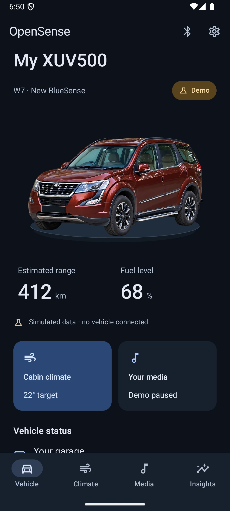
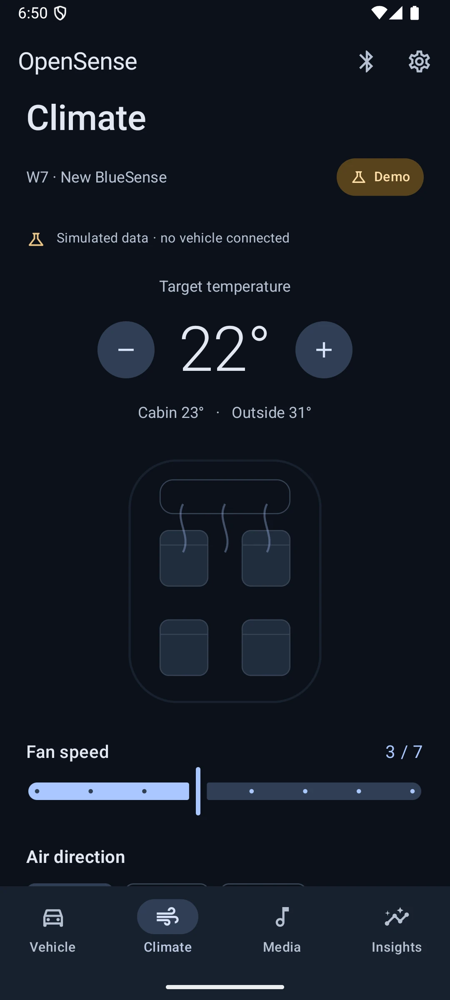
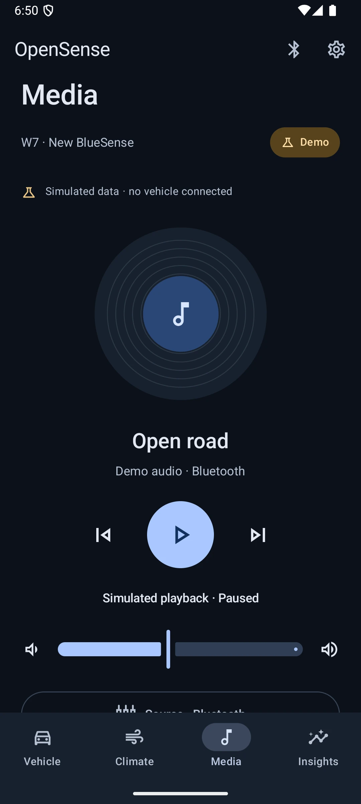
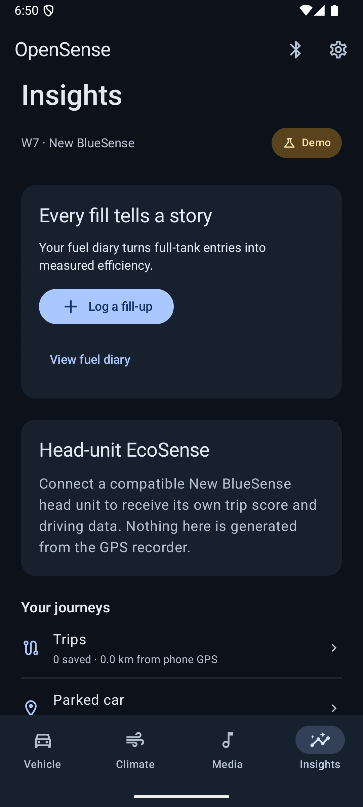
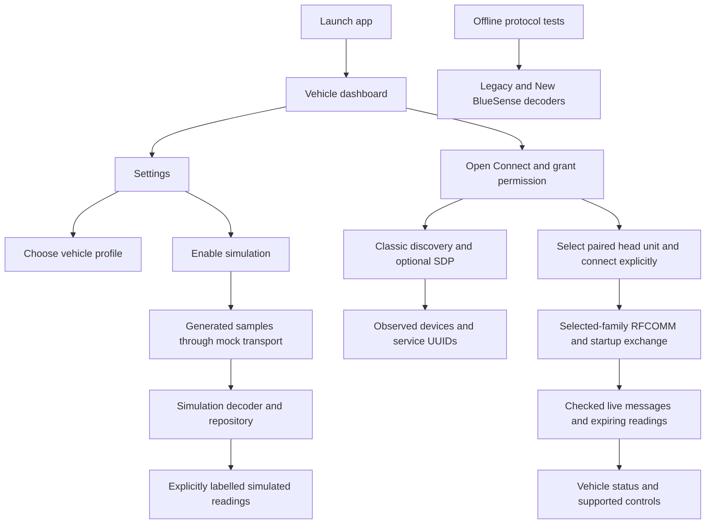

# OpenSense

[](https://github.com/Marshmellow31/OpenSense/actions/workflows/android.yml)
[](LICENSE)

An independent, native Android research preview for Mahindra XUV500 owners. A dark-first Material 3 garage view puts an illustrative XUV500 cutout on a platform, with dedicated Vehicle, Climate, Media and Insights screens. Vehicle profiles and optional simulation live in Settings.

OpenSense is unofficial and is not affiliated with Mahindra or the original BlueSense developers.

**Status: 0.1.0-dev · research preview.** The aim is a free, maintainable replacement
for compatible XUV500 BlueSense installations. The current APK is a functional
experimental compatibility build with separate Legacy and New BlueSense RFCOMM
sessions, APK-derived status decoding and supported media/climate commands.
**No physical head unit has been tested. Full original-app feature parity is not
complete.** The primary owner test target is a **2018 XUV500 W7**.

## Screenshots

Captured from the actual Android app on an emulator on **27 October 2026**,
at **1080 × 2400**, 420 dpi and normal (1.0×) text size. Populated vehicle,
climate and media screens use the app's simulation mode. **No vehicle was
connected; these images do not establish real head-unit compatibility.**

| Vehicle · demo | Climate · demo | Media · demo | Insights · demo |
| --- | --- | --- | --- |
|  |  |  |  |

[All eight WebP captures, settings and reproduction details](docs/screenshots/2026-10-27/README.md).

## Progress at a glance

Last evidence update: **24 October 2026**. See [PROGRESS.md](PROGRESS.md) for the
full handoff, remaining issues and validation boundaries.

| Workstream | Progress | Evidence / remaining work |
| --- | --- | --- |
| Identify both original app families | Complete for two selected artifacts | Package/version, hashes, manifests and signing checks recorded |
| Static whole-package analysis | Inventory and export complete; semantics partial | REA/JADX inspection plus Java/resources and Smali exports; decompiler limitations documented |
| Bluetooth and framing investigation | Established from static APK paths | Classic SPP in both apps, with different packet formats; vehicle captures still needed |
| Independent protocol decoders | Implemented and locally tested | Separate legacy/new decoders used by explicit vehicle sessions |
| Vehicle-family / variant selection | Implemented in Settings | Legacy and New BlueSense profiles; selection is not compatibility detection |
| Simulated vehicle and app screens | Implemented | Settings-only simulation entry, interactive local climate/media previews, feature states, diagnostics and settings |
| Bluetooth discovery / service inspection | Implemented; physical radio validation pending | Permission-aware Classic discovery and standard SDP |
| Private ownership tools | Implemented | Fuel diary, reminders, records, documents/manual, parking, GPS trips and assistance; [scope](docs/phone-feature-parity.md) |
| Local validation | Passing | 53 JVM and three Python tests; 20 normal-phone tests; 13 compact-phone tests at 1.3× text; separate injected/background GPS check |
| Public CI / development APK | Check latest run | [Android checks](https://github.com/Marshmellow31/OpenSense/actions/workflows/android.yml) builds/tests/lints and provides `OpenSense-debug`; old artifact is historical |
| Real head-unit compatibility | Pending | Exact head-unit/firmware identification and consented parked captures |
| Vehicle controls | Experimental implementation | Legacy media; newer media and HVAC; effects need parked hardware confirmation |
| UI polish | Native review corrections resolved | Portrait, dark-first Material 3; normal/large-text captures; all three material fixes scored resolved |

The table distinguishes static evidence, local test results and pending hardware
proof. Neither original app was installed or executed during this investigation.

## What works today

The phone expansion adds a portrait **Your garage** area: fuel
diary/efficiency, dated reminder notifications, private owner/vehicle records,
document/manual links, parked-car location/maps, foreground GPS trip history,
warning preferences, assistance dial/share handoffs and non-identity export.
New radio presets and APK-derived current EcoSense data are also implemented.
[Feature-by-feature scope and remaining proof](docs/phone-feature-parity.md).
The user chose private local storage and Android sharing, excluding cloud and Wear OS.

- Vehicle selection for the two historical BlueSense app families under Settings, followed by a variant choice. These are research profiles; selecting one does not establish compatibility or block access to the dashboard.
- Simulated fuel, range, climate, and door status with explicit simulation labels.
- User-initiated Classic Bluetooth discovery and standard SDP service inspection, subject to Android permissions.
- Explicit paired-head-unit RFCOMM sessions for each family, checked live messages,
  expiring readings and APK-derived media/newer-HVAC commands. Hardware acceptance
  is still unverified; [current scope and first test](docs/live-integration.md).
- A feature catalogue that keeps unverified capabilities unavailable, theme preferences, and bounded in-memory diagnostic events.
- Dark by default, with a persisted light-theme option, native Material icons and four portrait-phone tabs. A real-photo cutout has the background, registration text and aftermarket roof carrier removed; [asset provenance](docs/assets/README.md) records its CC0 source and image-edit prompts.

**Vehicle communication remains unverified on hardware.** Settings → Bluetooth connection now lets you select a paired head unit and explicitly open the selected family's SPP socket. Startup/status messages are automatic within that session; supported media/HVAC commands are user-triggered. Stale values clear after 20 seconds; disconnect/background/profile changes clear the session. The `SIM1` demo remains isolated. See [what matches the originals and what remains](docs/live-integration.md).

The two research targets are the original `com.visteon` app, version `0.46`, and `com.contus.mahindra.xuv500`, version `3.5`. Use the research documentation for evidence and provenance; package names alone do not authenticate a publisher. Neither original app needs to be installed to build or run OpenSense.

## How this project was built

The investigation began with an empty workspace. Instead of assuming the two apps
shared a protocol, each artifact was identified and analyzed separately:

1. **Find and preserve the inputs.** Research manufacturer/developer documentation
   and archival version listings, then download the two selected APKs into a
   private input folder. Record source URLs, acquisition method, sizes and SHA-256.
2. **Check identity and declarations.** Use Android SDK `aapt2` for manifest/badging
   and `apksigner` for signature verification. A valid signature and matching archive
   fingerprint establish consistency, not independent publisher authentication.
3. **Inspect with [REA](https://github.com/morluto/rea).** Use its local CLI, version
   6.5.0, with JDK 21 and headless JADX 0.7.1. Verify the engine JAR against REA's
   pinned SHA-256 before use. Inspect package declarations, class inventories,
   selected methods and incoming references without launching either APK.
4. **Trace across the package.** Export the full Java/resources and class-level
   Smali privately, map application modules, then follow connection setup, socket
   reads/writes, framing, checksum and feature-dispatch paths. Keep decompiler errors
   explicit rather than treating generated Java as complete original source.
5. **Implement independently.** Write new Kotlin framing decoders and synthetic
   tests from the documented behavior. Build a separate Compose app, mock transport,
   lifecycle repository and capability model. Proprietary source and assets are
   not copied into the public implementation.
6. **Validate the foundation.** Exercise malformed/fragmented streams and connection
   lifecycle cases, build/lint the Android app, and test profile selection and
   simulation on an emulator. Hardware behavior remains a separate verification gate.

The legacy package has **268 class rows including inner classes / 58 top-level
classes**, with one Java decompilation error. The newer package has **4,170 rows /
2,095 top-level classes**, with eight errors and forty warnings. Smali exports
preserve further inspection paths. These counts describe inventory/export
coverage; they do not mean every method's behavior has been fully reconstructed.

### What the two protocols revealed

Both inspected connection paths use Bluetooth Classic serial communication and
the standard SPP UUID, but their wire formats are different:

| Family | Static connection evidence | Incoming framing / integrity |
| --- | --- | --- |
| Legacy `com.visteon` 0.46 | Secure RFCOMM socket factory | `ED` / `EE` binary envelope, length field and CRC-16 |
| New `com.contus.mahindra.xuv500` 3.5 | Insecure RFCOMM socket factory; legacy reflective fallback present | Nibble encoding with incoming 0x50 offset, length field and additive checksum |

OpenSense implements the framing as independently testable parsers. Sharing an SPP UUID does
not make the profiles interchangeable. Exact session requirements, telemetry
units, head-unit firmware behavior and per-variant support need corroborating
captures. The specifications include class/method anchors and REA Evidence IDs:
[protocol overview](docs/protocol.md), [legacy](docs/protocol-legacy.md),
[new BlueSense](docs/protocol-new.md).

## How the OpenSense APK works

OpenSense is a new native Android application, package `org.opensense.app`. It is
not a patched or repackaged BlueSense APK. It uses Kotlin, Jetpack Compose,
Material 3, a view model, coroutines and Flow, with three Gradle modules:

| Module | Responsibility |
| --- | --- |
| `app` | Screens, navigation, permissions, view model and theme/profile preferences |
| `core` | Separate simulation/live models, framing, command encoders, session state and diagnostics |
| `bluetooth` | Android Classic discovery/SDP, selected-family RFCOMM connection and bounded session lifetime |



**Simulation:** enabling Simulation in Settings starts a cancellable sample
stream. The repository decodes the test-only `SIM1` format and publishes state to
the UI. These values are generated locally; they do not come from a car. Stopping
simulation, changing profiles or leaving the app clears the session/readings.
Climate set-point/fan/airflow and media source/track/playback/volume changes are
local preview state. The media screen does not play sound or control a head unit.

**Bluetooth:** discovery/SDP and paired-head-unit selection are separate actions.
Paired names are visible locally for deliberate selection, while discovery labels
and diagnostic logs remain redacted. Connecting stops simulation, opens secure
SPP for Legacy or insecure SPP for New BlueSense, sends startup/status requests,
and interprets checksum-valid messages. Socket connection alone is not a successful
application handshake. No BLE GATT or safety-critical ECU path is implemented.

**Capabilities:** selecting a trim records research context. Unsupported vehicle
features remain unavailable; demo support is labelled simulated. TPMS, EcoSense
and parked-location support are not inferred from the car name or original UI.

**Parsing:** the recovered framing decoders are libraries exercised by synthetic
tests and used by the separate live session. Readings remain APK-derived until
checked against hardware. The newer format requires a known frame boundary; its
stream parser stops on alignment loss rather than guessing synchronization.

**Storage and diagnostics:** theme, selected vehicle profile and user-created
garage records persist privately. Diagnostic events contain predefined codes and
timestamps, are capped at 100 entries, and stay in memory. They have no file export
or automatic upload and disappear when the app process ends. There is no account,
analytics or cloud service. For testing and returning useful feedback, follow the
[first tester handoff](docs/tester-handoff.md).

## Get a development APK

For the first experimental tester build, use the
[GitHub prerelease](https://github.com/Marshmellow31/OpenSense/releases/tag/v0.1.0-dev)
and follow the [tester handoff](docs/tester-handoff.md). Diagnostics are enabled
automatically but must be captured before restarting the app. Physical head-unit
compatibility is still unverified.

Build locally using the instructions below, or open
[Android checks in GitHub Actions](https://github.com/Marshmellow31/OpenSense/actions/workflows/android.yml).
Select a successful run and download the **OpenSense-debug** artifact from its
Artifacts section. Unzip it to obtain `app-debug.apk`. Artifacts are generated
only when that run's checks pass and are retained for 14 days. GitHub may require
sign-in to download them.

This is a debug research build, not a production release or a verified vehicle
replacement. There is no published Play Store release. The original archival
APKs are not distributed in this repository or in CI artifacts.

The [first successful published build](https://github.com/Marshmellow31/OpenSense/actions/runs/38847498840)
is from commit `6c25274`, verified on 16 October 2026. Its `OpenSense-debug`
artifact is available until 30 October 2026; use a newer successful run after
that date or build locally. The final publication-status documentation update
does not change that tested application code.

## Build

Requirements: JDK 21, Android SDK platform 37, Build Tools 36.0.0, and Internet access for dependency downloads. The checked-in wrapper selects Gradle 9.5.0. The project uses AGP 9.3.0, Kotlin 2.3.21, and Compose BOM 2026.09.00. Minimum Android version is 8.0 (API 26); target and compile SDK are 37.

From PowerShell at the project root, substitute the actual installed JDK and SDK paths:

```powershell
$env:JAVA_HOME = 'C:\path\to\jdk-21'
$env:ANDROID_HOME = "$env:LOCALAPPDATA\Android\Sdk"
$env:Path = "$env:JAVA_HOME\bin;$env:Path"
& "$env:ANDROID_HOME\cmdline-tools\latest\bin\sdkmanager.bat" 'platforms;android-37.0' 'build-tools;36.0.0' 'platform-tools'
.\gradlew.bat :core:test :app:lintDebug :bluetooth:lintDebug :app:assembleDebug
```

If SDK licenses are requested, review and accept them using `sdkmanager.bat --licenses`. `ANDROID_HOME` can locate the SDK without checking in machine-specific `local.properties`. The debug APK is produced at `app/build/outputs/apk/debug/app-debug.apk`; it is a local development artifact, not a production release.

Android Studio must support AGP 9.3.0 for IDE sync. Use the command-line build if
your IDE version does not support the project's pinned plugin version.

On macOS/Linux, set `JAVA_HOME` and `ANDROID_HOME` to local installation paths and use `bash ./gradlew` with the same task names.

## Explore the app

1. Install your local debug build on a test phone and launch OpenSense. The Vehicle screen opens directly; a fresh installation defaults to dark mode.
2. Open the top-right **Settings** button to choose the app generation and variant (or “Other / unsure”). Year alone cannot identify a replacement head unit. A profile is optional for exploring the UI.
3. In **Settings**, enable **Simulation** to explore generated readings and interactive climate/media previews. Disable it there to clear the demo session. No simulation-start button is placed on the main dashboard.
4. For discovery, open the top-bar Bluetooth button or Settings → Bluetooth connection. Grant Nearby devices permission on Android 12+, or Location permission on Android 8–11. Earlier Android versions may also require system Location to be enabled. Pairing and identification take place in Android settings.
5. For an experimental parked test, choose the correct generation in Settings, pair normally, then use Bluetooth connection → Refresh paired head units → Connect. Verify incoming messages and readings before trying supported controls. The first test sequence is in docs/live-integration.md.
6. Use Vehicle, Climate, Media and Insights for the main app. Diagnostics is inside Connection; appearance and profile selection stay in Settings. Leaving the app stops discovery, simulation and vehicle sessions; reconnecting requires a user action.

Discovery results use generic device labels. A listed device or returned UUID does not prove BlueSense support. Do not interpret simulated values as vehicle measurements.

## Validation and next milestones

The historical public baseline was **28 JVM tests**, **3 Python tests** and **3 Compose
UI tests** passing on an Android 16/API 36 emulator. App lint reported zero errors
and six warnings; Bluetooth lint reported zero errors and two warnings. These are
local results, distinct from the live CI badge above. The pipeline builds/lints
and runs JVM/Python tests; it currently does not run the emulator UI suite.

Current live-integration tests, build evidence and limits are recorded in
[PROGRESS.md](PROGRESS.md) and [live integration](docs/live-integration.md).
The old public CI artifact predates this milestone; select a successful run for
the current main revision to download its development APK.

Next milestones:

- [x] Build portrait phone features and verify normal/large-text layouts; resolve the native review's material fixes.
- [ ] Identify the primary W7's factory/replacement head unit and exact firmware.
- [ ] Corroborate both framing specifications with authorized parked captures.
- [ ] Confirm initialization effects, field validity, units and per-feature hardware.
- [x] Implement separate explicit vehicle sessions, command encoders and expiring live data.
- [ ] Validate those sessions, read mappings and command effects against actual head units.
- [ ] Verify physical-phone permissions, radio coexistence and reconnection.
- [ ] Enable individual features only after evidence-backed compatibility checks.

Start with the [vehicle evidence checklist](docs/vehicle-test-plan.md). Testing
must be limited to an owned or explicitly authorized vehicle while safely parked.
Newly reverse-engineered controls require explicit owner approval; firmware changes,
authentication bypass and safety-critical ECU access are outside this project scope.

## Privacy and research materials

The app has no Internet permission, account, analytics, or automatic cloud sync.
Theme/profile and user-created garage records persist privately. Explicit parking
location and user-started GPS trips also persist until removed; document links use
user-granted provider access. Diagnostics contain enum codes/timestamps and exclude
identifiers, raw packets, locations and exception text. Standard export excludes
identity fields, documents, parking coordinates and GPS traces.

Original APKs, decompiled source, packet captures, and private analysis stay outside public contributions. `apk-input/`, `private-analysis/`, and `tools-local/` are ignored. Do not attach those materials to public issues or releases. The optional static inventory utility is documented in [testing](docs/testing.md).

## Contribute

See [research](docs/research.md), [protocol findings](docs/protocol.md), [compatibility](docs/compatibility.md), [vehicle evidence needed](docs/vehicle-test-plan.md), [architecture](docs/architecture.md), [testing](docs/testing.md), [contribution guidance](CONTRIBUTING.md), and [security reporting](SECURITY.md). Current build and device validation evidence must be reported separately; a successful build does not establish real-car compatibility. Physical-device and vehicle verification remain pending.

OpenSense's original code is licensed under [MIT](LICENSE). This license does not grant rights to original BlueSense APKs, branding, or other third-party material. MIT was selected as a simple permissive license for the independently authored implementation.
